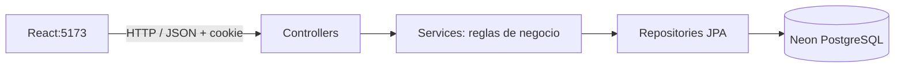
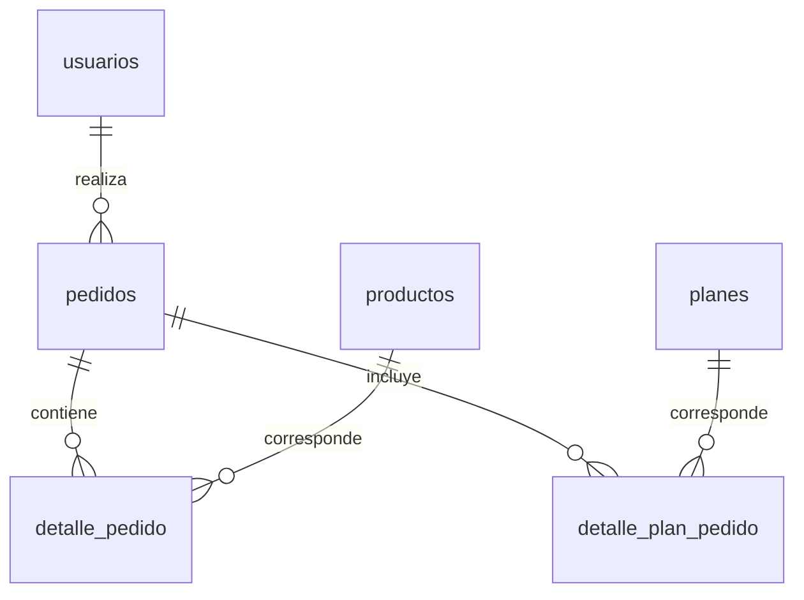

THE REYES RECORDS | Backend Spring Boot y Neon
API REST para el proyecto académico de tienda musical y planes de disquera
Módulo: Desarrollo Fullstack II

1. ¿Qué construimos y por qué?
El backend de THE REYES RECORDS se desarrolló con Java 21 y Spring Boot para conectar el sitio React con la base de datos PostgreSQL de Neon. Antes, varias vistas trabajaban con información local; con esta integración, el sistema puede guardar usuarios y compras, consultar productos activos y mantener un historial real de pedidos.
Su objetivo principal es no confiar en los datos enviados por el navegador: el backend identifica al usuario autenticado, valida productos/planes, consulta los precios en Neon, comprueba el inventario y registra las compras dentro de una transacción.
Alcance del proyecto: es una aplicación académica. La compra utiliza medio_pago = simulado y estado = aprobado_simulado. No procesa pagos reales ni tarjetas bancarias.

2. Resumen para el docente: ¿qué implementamos?
Módulo	Lo desarrollado	Evidencia o demostración
Conexión a Neon	Configuración PostgreSQL mediante variables de entorno	Arranque del backend y respuesta JSON de /api/productos
Usuarios	Registro, login con BCrypt, roles y sesiones HTTP	Iniciar sesión desde React, actualizar con F5 y cerrar sesión
Catálogo	Consultar productos; crear, editar y desactivar con rol admin	Comprobar en Neon activo = false para el producto de prueba ID 7
Pedidos	Crear compra simulada, calcular totales desde Neon y guardar detalles	Mostrar pedidos y detalle_pedido
Inventario	Verificar stock, bloquear filas y descontar solo productos físicos	Mostrar stock antes/después de una compra de laboratorio
Planes	Tabla de planes y registro de contrataciones	Mostrar Plan Básico en pedido N.º 5 en Neon
Historial	Devolver únicamente pedidos asociados al usuario autenticado	Consultar GET /api/pedidos/mis-compras desde React
Seguridad	Sesiones, roles administrativos, token CSRF para modificaciones de productos	Revisar SecurityConfig.java y /api/csrf

Qué agregamos para las compras de planes
El backend inicialmente registraba únicamente productos físicos. Para admitir planes musicales sin perder compatibilidad con compras anteriores, realizamos estos cambios:
1. Creamos la entidad Plan.java y su repositorio PlanRepository.java, relacionados con la tabla planes.
2. Creamos la entidad DetallePlanPedido.java y DetallePlanPedidoRepository.java, relacionados con detalle_plan_pedido.
3. Actualizamos PedidoRequest.java para aceptar tipo: "producto" o tipo: "plan" por artículo. Cuando no se envía tipo, se interpreta como producto para compatibilidad.
4. Actualizamos PedidoService.java: agrupa artículos por tipo e ID, obtiene precios desde Neon, valida productos y planes, guarda la compra y descuenta stock solo de productos físicos.
5. Actualizamos PedidoController.java para devolver en el historial las listas productos y planes asociadas a cada pedido.
El mismo ID numérico puede existir en ambas tablas: producto-1 y plan-1 son artículos diferentes.
3. Tecnologías y arquitectura
- Java 21 y Spring Boot 4.1.1.
- Maven Wrapper para compilar y ejecutar.
- Spring Web MVC para controladores REST y respuestas JSON.
- Spring Data JPA / Hibernate para operaciones con entidades y repositorios.
- Neon PostgreSQL como base de datos persistente (neondb).
- Spring Security para autenticación, autorización y sesiones.
- BCrypt para almacenar hashes de contraseñas.
- Bean Validation para validar solicitudes.

¿Para qué sirve cada carpeta?
Carpeta	Responsabilidad
controller	Recibe peticiones HTTP (GET, POST, PUT, DELETE) y prepara respuestas
service	Implementa reglas: validación, stock, cálculo del total y transacciones
repository	Accede a Neon mediante interfaces Spring Data JPA
model	Define entidades relacionadas con tablas PostgreSQL
dto	Representa la información que acepta la API para registro, login y pedidos
config	Configuración de seguridad y CORS

4. Modelo de datos en Neon
Se trabajó con seis tablas:
Tabla	Datos principales	Relación
usuarios	Nombre, correo, password_hash, rol, estado y contacto	Un usuario puede tener varios pedidos
productos	Nombre, categoría, precio CLP, stock, imagen y activo	Puede aparecer en varios detalles de pedido
pedidos	Usuario, datos de cliente, dirección, total, fecha y estado	Encabezado de la compra
detalle_pedido	Producto, cantidad, precio unitario y subtotal	Productos físicos del pedido
planes	Nombre, descripción, precio CLP, imagen y activo	Catálogo de servicios
detalle_plan_pedido	Plan, cantidad, precio unitario y subtotal	Planes contratados en el pedido

Importante: las tablas se crearon mediante SQL en Neon. spring.jpa.hibernate.ddl-auto=none indica que el backend no genera ni actualiza automáticamente el esquema: para instalar el sistema en otra base se necesitan las tablas respectivas.
Planes disponibles
ID	Plan	Precio (CLP)
1	Básico	$50.000
2	Premium	$70.000
3	Gold	$85.000
4	Deluxe	$180.000

La pantalla React muestra estos precios localmente; el precio usado para guardar la compra proviene de Neon. Todavía no se agregó un endpoint público GET /api/planes.
5. Flujos implementados
Registro e inicio de sesión
1. React envía los datos de registro a POST /api/usuarios/registro.
2. Spring Boot guarda el usuario con rol de cliente y contraseña hasheada con BCrypt.
3. En POST /api/usuarios/login se verifica la contraseña y se crea una sesión autenticada.
4. GET /api/usuarios/sesion permite recuperar la identidad después de actualizar React.
5. POST /api/usuarios/logout invalida la sesión.
Autenticación responde «¿quién es?». Autorización responde «¿qué acciones puede realizar?». Crear, editar o desactivar productos corresponde al rol administrador en el backend.
CRUD de productos
- Crear: agrega un producto nuevo al catálogo.
- Consultar: recupera productos activos o un producto por ID.
- Editar: actualiza información de productos existentes.
- Desactivar: cambia activo a false, sin eliminar físicamente la fila; así no se pierde la referencia histórica de las compras.
Se comprobó que el producto de laboratorio ID 7 permaneció en PostgreSQL después de desactivarlo, con stock 8 y activo = false.
Compra simulada de productos y/o planes
1. React envía datos del cliente e ítems con id, cantidad y tipo a POST /api/pedidos.
2. Spring Boot comprueba que los artículos existan y estén activos.
3. Para productos físicos, verifica que el stock alcance y utiliza un bloqueo pesimista durante la transacción.
4. Para planes, consulta la tabla planes. No descuenta inventario físico por una contratación.
5. Calcula los subtotales y el total real en CLP desde Neon, no desde el valor enviado por React.
6. Dentro de una operación @Transactional, guarda el encabezado en pedidos, los productos en detalle_pedido y los planes en detalle_plan_pedido; descuenta stock cuando corresponde.
7. Devuelve el número de pedido, el total y aprobado_simulado; React muestra la confirmación.
8. GET /api/pedidos/mis-compras obtiene los pedidos vinculados a la sesión autenticada y sus productos/planes.
@Transactional permite revertir los cambios del conjunto ante errores que provoquen rollback. No significa que todas las pruebas de fallos o concurrencia ya se hayan ejecutado: eso todavía debe verificarse.
6. Endpoints principales
Método	Endpoint	Uso
POST	/api/usuarios/registro	Registrar cliente
POST	/api/usuarios/login	Iniciar sesión
GET	/api/usuarios/sesion	Consultar sesión activa
POST	/api/usuarios/logout	Cerrar sesión
GET	/api/productos	Listar productos activos
GET	/api/productos/{id}	Consultar detalle
POST	/api/productos	Crear (administrador)
PUT	/api/productos/{id}	Editar (administrador)
DELETE	/api/productos/{id}	Desactivar (administrador)
POST	/api/pedidos	Procesar compra simulada
GET	/api/pedidos/mis-compras	Historial del usuario autenticado
GET	/api/csrf	Obtener token CSRF para acciones protegidas

Formato de un pedido mixto (ejemplo ilustrativo)
{
  "cliente": {
    "nombre": "Cliente",
    "apellido": "Ejemplo",
    "email": "ejemplo@correo.cl",
    "direccion": "Calle de Prueba 123",
    "comuna": "Santiago",
    "region": "Región Metropolitana",
    "metodoPago": "simulado"
  },
  "items": [
    { "id": 1, "cantidad": 1, "tipo": "producto" },
    { "id": 1, "cantidad": 1, "tipo": "plan" }
  ]
}
No ejecutar esta solicitud contra la base del proyecto sin coordinar una prueba: si el servidor la acepta, registra un pedido y puede descontar stock. El JSON solo ilustra el formato de los ítems.
7. Instalación y ejecución local
Requisitos: JDK 21, conexión a internet, acceso autorizado a Neon y las seis tablas creadas.
git clone https://github.com/johao-riquelme/backend-disquera.git
cd backend-disquera\disquera-backend
src/main/resources/application.properties usa estas variables:
spring.datasource.url=${DB_URL}
spring.datasource.username=${DB_USER}
spring.datasource.password=${DB_PASSWORD}
server.port=8081
Se configuran en la misma terminal desde la que se ejecuta Spring Boot. Ejemplo de formato con marcadores (no contiene contraseñas válidas):
$env:DB_URL = "jdbc:postgresql://TU_HOST_DE_NEON/neondb?sslmode=require"
$env:DB_USER = "TU_USUARIO_DE_NEON"
$env:DB_PASSWORD = "TU_CONTRASENA_ACTUAL"

.\mvnw.cmd spring-boot:run
Seguridad: nunca subir valores reales de esas variables, cadenas de conexión con contraseña, datos de clientes ni archivos .env privados a GitHub. La contraseña utilizada anteriormente durante el desarrollo fue compartida y debe restablecerse en Neon. Evitar pegar claves en comandos que queden guardados en el historial de PowerShell.
Arranque correcto: buscar HikariPool-1 - Start completed, seguido de Started DisqueraBackendApplication. Luego abrir http://localhost:8081/api/productos: debe mostrar JSON de productos activos.
En otra terminal, ejecutar el frontend (npm run dev); la app estará normalmente en http://localhost:5173.
8. Compilación, pruebas y evidencias
# Comprobar compilación de Java
.\mvnw.cmd clean compile

# Ejecutar pruebas del backend (pendiente de registrar resultado final)
.\mvnw.cmd test
Resultados realmente observados
Evidencia	Resultado
Compilación final de los archivos Java	BUILD SUCCESS, 26 archivos compilados después de integrar planes
Contratación Plan Básico	Pedido N.º 5, total $50.000 CLP, estado aprobado_simulado
Persistencia de contratación	Confirmada en Neon mediante relación pedidos → detalle_plan_pedido → planes
Historial de cliente	Pedido N.º 5 visible como Planes Contratados; pedido N.º 4 de producto físico sigue visible
Desactivación de producto	Producto de laboratorio ID 7: activo = false, stock conservado

Diferencia: compilar Java no es lo mismo que ejecutar pruebas unitarias. Aquí no se ha registrado una batería completa de Maven con resultado aprobado, y la compra mixta todavía no se verificó de extremo a extremo.
Consultas SQL para mostrar al docente (solo lectura)
-- Catálogo físico y estado de los productos
SELECT id, nombre, categoria, precio, stock, activo
FROM productos ORDER BY id;

-- Planes musicales almacenados en Neon
SELECT id, nombre, precio, activo
FROM planes ORDER BY id;

-- Contrataciones de planes asociadas a un pedido
SELECT p.id AS numero_pedido, pl.nombre AS plan,
       dp.cantidad, dp.precio_unitario, dp.subtotal,
       p.total, p.estado
FROM pedidos p
JOIN detalle_plan_pedido dp ON dp.pedido_id = p.id
JOIN planes pl ON pl.id = dp.plan_id
WHERE p.id = 5;
Estas consultas no modifican los registros. No mostrar en la exposición password_hash, credenciales ni datos personales innecesarios de clientes.
Guion de demostración breve (5 minutos)
1. Abrir /api/productos para mostrar que la API responde desde Neon.
2. Explicar Controller → Service → Repository → PostgreSQL usando el código Java.
3. Abrir en Neon las tablas usuarios, productos, pedidos, detalle_pedido, planes y detalle_plan_pedido.
4. Mostrar el producto ID 7 desactivado y explicar el borrado lógico.
5. Mostrar el pedido N.º 5 en Neon y relacionarlo con la vista «Mis Compras» de React.
6. Explicar por qué el total se calcula en el servidor y por qué los planes no descuentan stock.
9. Seguridad y limitaciones reconocidas
- El proyecto utiliza sesiones HTTP, BCrypt, roles y CSRF en operaciones administrativas de productos.
- Las políticas del laboratorio tienen exenciones temporales de CSRF (incluido /api/pedidos) y deben endurecerse antes de producción.
- Actualmente se permite realizar compras simuladas como invitado, pero «Mis Compras» exige una sesión válida para mostrar los pedidos asociados a un usuario.
- El frontend debe revisar sus rutas administrativas; la autorización efectiva de las acciones debe permanecer en el servidor.
- Faltan pruebas integrales de compras mixtas, de los otros tres planes y de situaciones de error/concurrencia.
- El repositorio no incluye migraciones versionadas del esquema creado en Neon; prepararlo en otra base requiere el SQL correspondiente.
- No está listo como tienda con pagos reales ni como despliegue de producción.
